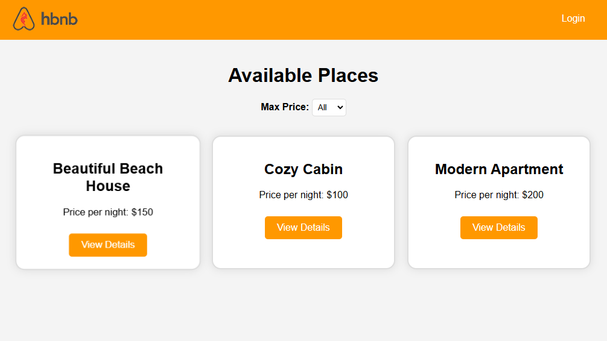
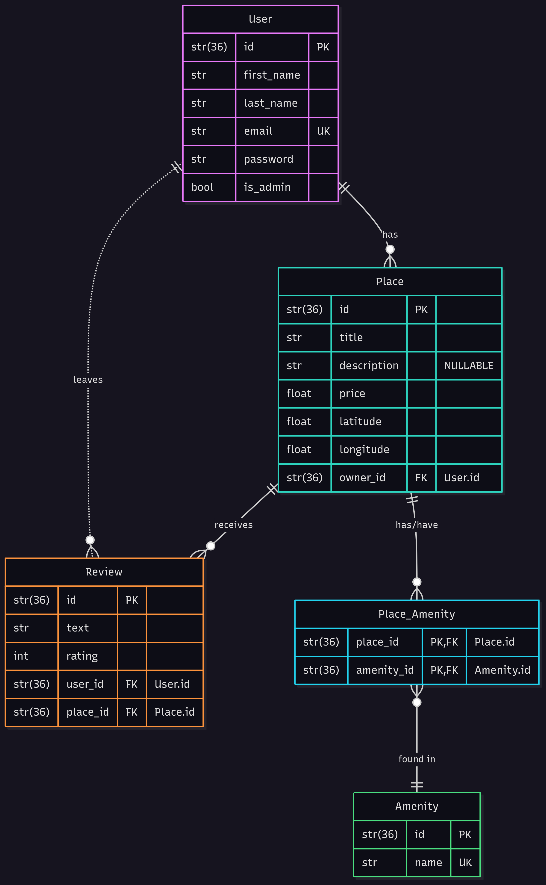
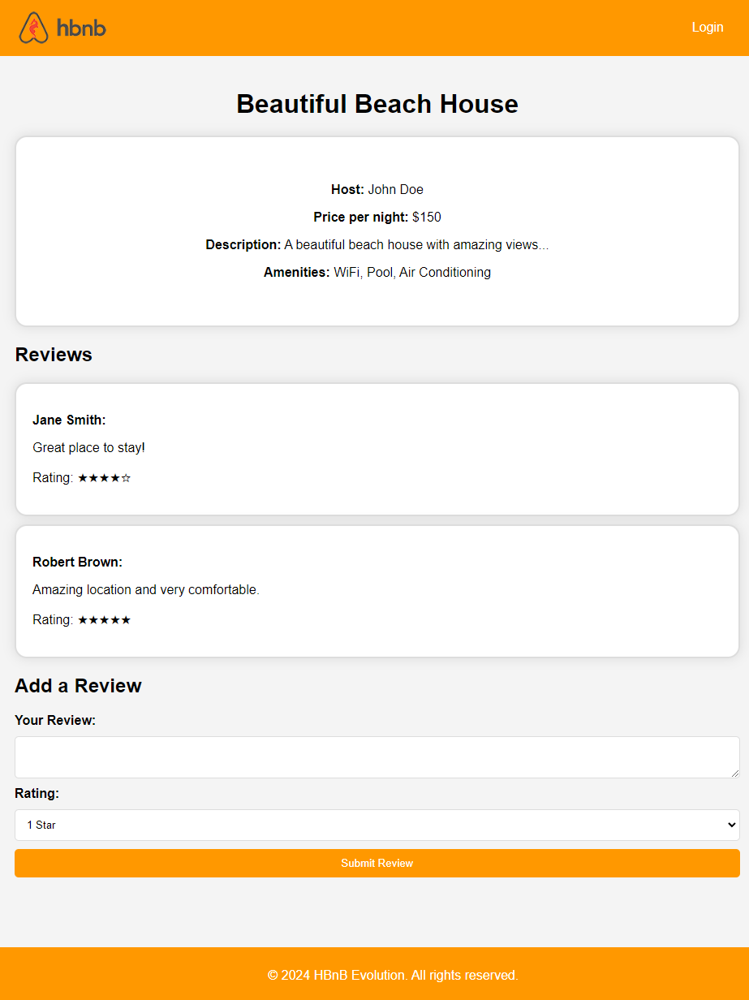

# HBnB: an Airbnb-like web application

A full-stack rental-listing application built in four stages, from UML design to a working web client: a **Flask REST API** with a three-layer architecture, **JWT authentication** and role-based access, **SQLAlchemy** persistence, and a **JavaScript** front end. Pair project for Holberton School (June–July 2025), built over four Scrum sprints.

| | |
|---|---|
| **Back end** | Python 3.13, Flask, Flask-RESTx (Swagger docs), Flask-JWT-Extended, Flask-Bcrypt, SQLAlchemy |
| **Database** | SQLite, through the SQLAlchemy ORM |
| **Front end** | HTML5, CSS3, JavaScript (ES6) |
| **Architecture** | Presentation / business logic / persistence layers behind a facade; repository pattern |
| **Tests** | 47 automated tests on the final application (models, validation, relationships), run on every push by GitHub Actions |

**Run it:** see [INSTALLATION.md](INSTALLATION.md). In short, from `part4/hbnb`: install `requirements.txt`, create the SQLite database from `create_tables.sql`, then `python run.py`. The web client opens at http://127.0.0.1:5000/ and the Swagger API documentation at http://127.0.0.1:5000/api/v1.

**Run the tests:** from `part4/hbnb`, `pip install pytest`, then `python -m pytest tests`.

## The four stages

Each folder keeps the state of the project at the end of its stage; `part4` is the final application.

### 1. Technical documentation (`part1`)

UML diagrams and explanatory notes describing the architecture, the business logic and the interactions between components:
- a high-level package diagram of the three-layer architecture and its facade;
- a class diagram of the models and their relationships;
- sequence diagrams for the main API calls: user registration, place creation, review submission, fetching a list of places, user login.

### 2. Business logic and API endpoints (`part2`)

The presentation and business-logic layers in Python and Flask, over an in-memory repository:
- **Business logic:** the core models (User, Place, Review, Amenity), their relationships and data validation;
- **Presentation:** REST endpoints for each entity with Flask-RESTx (auto-generated Swagger documentation), wired to the business logic through a facade;
- **Testing and validation:** unit tests of the models and black-box tests of the endpoints.

### 3. Authentication and database (`part3`)

Securing the API and replacing in-memory storage with a database:
- **Password hashing** with bcrypt, and **JWT authentication** (Flask-JWT-Extended) so that only authenticated users reach protected resources;
- **Role-based access control:** users can only change their own data; administrators manage users and amenities and can bypass ownership checks;
- **SQLAlchemy persistence:** an SQLAlchemy repository replaces the in-memory one behind the same interface; users, places, reviews and amenities are mapped with their one-to-many and many-to-many relationships, on SQLite;
- **SQL scripts** to create the tables and load initial data (`create_tables.sql`, `populate_sample_db.sql`), and entity-relationship diagrams.

### 4. Web client (`part4`)

An interactive front end in HTML5, CSS3 and JavaScript (ES6, Fetch API) connected to the API, without page reloads:
- **Login** against the API, with the JWT stored in a cookie for the session;
- **List of places** with client-side filtering by price;
- **Place details**: description, price, amenities and reviews;
- **Add a review**, for authenticated users only.

## Authors

- [Delphine Coutouly-Laborda](https://github.com/Delphes1980) (stages 1 to 3)
- [Xavier Laforgue](https://github.com/XavierLaforgue)
